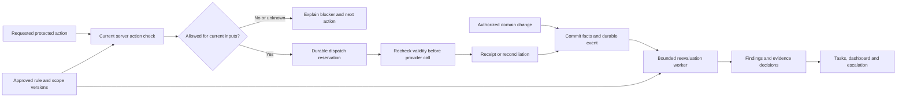

# Compliance Risk & Gaps — product and engineering specification

Status: proposed implementation specification, November 10, 2026. No risk engine, production approval or action gates are delivered by this document. The current Compliance register is research-only. Read the [delivery plan](risk-and-gaps-plan.md), [regulatory implementation backlog](implementation.md) and [research scope](README.md) together.

## 1. Outcome and scope

At any point, authorized staff should be able to answer: what needs attention, why it matters, which activities/files it affects, who owns it, when it is due, what evidence resolves it, and whether the next action is permitted. Managers need an accurate picture of both operational exposure and the limits of Orbit's coverage.

Extend Workspace → Compliance into an operational workspace while preserving the source register as its Research tab. Connect its findings to existing Today, Tasks, loan details, Processing and Playbooks queues. Maintain one authoritative finding and remediation workflow across these surfaces.

Scope includes brokerage programs, jurisdiction/product/role approval, licenses, lead acquisition and outreach, application/disclosure/credit workflows, pricing and compensation, lender handoffs, closing records, retention/privacy/security, reporting and regulatory change. Findings can concern a brokerage, branch, person, lead, contact, campaign, loan, provider or control. A missing platform capability belongs in the register even when there are no loans yet.

UWM implementation remains the current priority; this is the next workstream. That sequence does not waive controls already required for any live UWM activity. Do not claim nationwide readiness, calculate a composite compliance score, automatically make credit decisions or generate binding legal interpretations from research summaries. DC, territories and unapproved products remain explicitly outside approved coverage.

## 2. Three distinct objects

| Object | Meaning | Example | Resolution |
| --- | --- | --- | --- |
| Requirement review | Legal applicability, authority or interpretation is unresolved | State disclosure timing sources conflict | Qualified reviewer records scope, authority, effective dates and approved interpretation; ambiguity is not converted into a guessed deadline |
| Control gap | Required capability or operational process is absent or unverified | No validated disclosure delivery/receipt integration | Implement or establish a legally permissible manual process, test it, retain operational evidence, approve its exact scope |
| Operational finding | An evaluated resource has a concrete issue or needs evidence/review | Required receipt missing for a specific package | Correct underlying facts or perform required work, verify evidence and reevaluate; closing a task alone does not resolve it |

Link these objects: a control gap can affect many scopes and produce scoped findings, but do not create thousands of duplicate engineering tickets. A requirement family is not an atomic executable rule. Preserve relationships to existing FED IDs, state sources and C01–C12 packages.

Separate an observed condition from a legal conclusion. Use “Receipt not verified” or “Deadline passed” when those facts are established; reserve confirmed-violation classification for an authorized determination with its basis. A missing receipt does not prove a document was never delivered.

## 3. Dimensions and status rules

Store these dimensions separately rather than combining them into a green/red score:

| Dimension | Values and behavior |
| --- | --- |
| Applicability | Applicable / Not applicable with reviewed basis / Unknown. Evaluate each relevant jurisdiction and role; one federal exemption does not exclude every state duty. |
| Source of requirement | Law/regulation / lender contract / brokerage policy / Orbit product restriction. Label internal rules clearly; do not present them as statutory requirements. |
| Coverage | Research only / Legal review pending / Approved rule / Implemented / Tested / Operationally evidenced / Released for exact scope. Store milestone evidence separately; a summary stage must not erase failed or revoked prerequisites. |
| Evaluation | Not evaluated / Current / Stale / Failed / Rebuilding. Store evaluated-through event sequence and input/rule versions. A stale prior pass is not a current pass. |
| Finding workflow | Open / In progress / Awaiting evidence / Awaiting review / Resolved / Not applicable / Superseded. A reopened issue returns to Open with a new occurrence and preserved history. |
| Impact | Critical / High / Moderate / Low / Unassessed, assigned by an approved impact rubric with a reason. Impact is distinct from uncertainty, urgency and whether an action is blocked. |
| Urgency | Overdue / Due soon / Upcoming / No determined deadline. Derive from the correct clock; a missing legal deadline is unknown, not infinitely far away. |
| Action decision | Allowed for this action and input version / Blocked / Review required / Unavailable. Review required or unavailable does not authorize a regulated external action that needs that determination. |

Critical is reserved for approved categories such as an immediate prohibited action or serious exposure requiring urgent escalation; High for material obligations needing prompt handling; Moderate/Low for lower-impact deficiencies. Legal/compliance review owns the rubric. Engineers must not infer severity from a keyword or promote every research question to a critical violation.

User-facing summaries:

- **Blocked:** name the specific action and the condition preventing it; offer the remediation path.
- **Action required:** an applicable open obligation needs work, with owner and deadline when known.
- **Review needed:** applicability, source, facts or evidence require a decision; explain which action cannot proceed pending it.
- **Evidence verified:** scoped evidence matched a requirement at a stated time/version. This never means the loan or brokerage is “fully compliant.”

Keep evaluation health visible alongside summaries. Never show “No issues” for an empty, incomplete, failed or rebuilding evaluation. Prefer “No open findings among 42 evaluated files; 6 still need evaluation,” with the current filter and timestamp.

## 4. Brokerage experience

Workspace → Compliance has five operational views plus Research:

1. **Overview:** action blockers, overdue obligations, reviews awaiting a decision, unassigned work, and evaluation-health banner. Each tile opens the exact filtered queue. Show finding count and distinct affected-file count separately; overlapping counts must not be added as unique exposure. Avoid speculative dollar penalties or “financial exposure” estimates.
2. **Work queue:** filters for object type, requirement/control/finding, impact, workflow, owner, due status, jurisdiction, product, activity, provider, evidence and evaluation freshness. Columns: issue, affected scope/record, blocked action if any, owner, due time, status and next action. Default ordering: critical escalation, overdue, blocked next action, due soon, other reviews; stable tie-breakers use deadline, first detected time and ID. No color-only meaning.
3. **Coverage & gaps:** state × product × role × activity coverage, with company/branch scope. Drill from a state to requirements, dependencies and unresolved questions. Separate “research entry exists” from “released for activity.” An unknown or unsupported state never inherits another state's approval. Count reviewed controls against a defined versioned denominator, not all possible law.
4. **Evidence & reviews:** review packages awaiting verification, expiring evidence, rejected/superseded artifacts, responsibility agreements, lawful exceptions and upcoming review dates. Approvers see exact scope and changes since the previous approval.
5. **History & reports:** finding occurrences, decisions, deadline calculations, rule versions, changes in scope, resolution and recurrence trends, and permission-scoped examination exports.
6. **Research:** retain current federal/state source explorer; link to approved rules and remaining questions. Published research revisions do not silently activate gates.

Finding detail opens in a drawer or dedicated detail route with persistent ID: plain-language problem; record and relevant jurisdiction; requirement/source; observed facts and uncertainty; affected action; owner and backup; statutory deadline and separate internal target; evidence checklist; provider/lender responsibility; activity/decision history; and one primary next action. Provide exact deep links back to the workbench. Returning to the queue preserves filters, cursor and focus.

Use the existing [design system](../design-system.md). On narrow screens preserve issue, status, deadline and primary action in stacked rows; secondary legal details can expand. Support keyboard, focus restoration, screen readers, readable timezones, error recovery and 200% zoom. Loading, unavailable, partial, empty and permission-denied states must be distinguishable.

## 5. Loan, lead and action experience

Loan header shows a compact summary such as “2 actions blocked · 1 review needed,” scoped to the viewer. A Compliance panel lists obligations, upcoming deadlines, evidence and decisions. Pipeline and Processing show the highest relevant blocker and link to the exact issue, without implying that an unrelated activity must stop. Lead/contact/campaign views show relevant outreach eligibility and consent issues before conversion.

At a protected action, present a concise server-derived result: action, blocker, owner and next step. Expanding shows authority and evidence. Do not expose internal implementation details in borrower or staff flows. Client button state is convenience only; the server reevaluates at execution.

| Action | Expected behavior |
| --- | --- |
| Save draft, correct facts, record opt-out, attach permitted evidence | Remains available within existing access controls; compliance blocking must not prevent remediation or recording a consumer request |
| Order live credit, send marketing, issue disclosure, submit to lender, request lock or release another regulated external action | Apply the approved action-specific rules and tenant scope; no dispatch without a current allowed decision |
| Log a real external event, including historical closing/funding or an outreach mistake | Allow accurate historical recording with actor, occurred-at and recorded-at; reevaluate and open/escalate issues. Never falsify or reject the history just to preserve status |
| Record mock/demo activity | Evaluate in explicitly fictional mode; no live authorization, verified-live evidence or production coverage may result |
| Export/report, purge or replace artifacts | Apply recipient authorization, confidentiality and retention/hold controls; keep remediation and lawful examination access available |

Example: a lender reports “Clear to Close,” but required receipt evidence is absent. Keep the lender's status as received, show the separate compliance issue and block only the affected action under its approved policy. Retrieving a matching lender artifact may resolve the missing-evidence issue; a late delivery can leave a separate deadline breach requiring remediation. Never rewrite lender status to imitate an Orbit compliance decision.

Borrowers see only actionable requests and neutral, accurate explanations appropriate to their role. Realtors see authorized milestones. Neither receives internal legal analysis, risk classifications, staff licensing investigations, SAR indicators or privileged material.

## 6. Ownership, remediation and escalation

Each active issue has an accountable internal owner, a backup/escalation role and a next action. Responsible external party (lender/provider) is a separate field; “waiting on lender” never removes internal accountability. Defaults are configurable by domain, team and jurisdiction and must resolve to active authorized members.

Open → In progress → Awaiting evidence/review → Resolved requires current evaluation and the rule's evidence predicate or authorized documented disposition. Assignment and acknowledgment cannot resolve a finding. Record not-applicable decisions with the reviewer, scope, supporting facts and rule version; reevaluate if facts or law change. Supersede only with a linked replacement and history. Group root-cause gaps without erasing individual missed deadlines.

Store legal deadlines independently from service targets, follow-up dates and escalation dates. Reassignment, hold, withdrawal, funding, task completion, provider outage or notification snooze never resets a legal clock. A lawful extension/exception needs its approved basis and evidence. Policy targets can be configured; they must be labeled as operational targets rather than legal deadlines.

Notify the owner at creation, material severity/deadline changes and approved escalation thresholds. Unassigned/unavailable-owner work goes immediately to the authorized backup queue. Use deduplicated reminders and optional digests for nonurgent items. Snoozing suppresses a reminder only; it cannot alter the finding, gate, original deadline or missed-event history. Track notification failure and route fallback work; do not rely on email delivery to make the obligation exist.

An exception is not a general admin override. It must specify the eligible rule, legally allowed basis, scope, independent approver where required, expiry and artifact. A product-policy waiver must not bypass a legal rule. Expiry or changed facts invalidates the exception. No exception may be backdated to hide a missed obligation. Human tasks must support truthfully recording that a violation occurred and what remediation followed.

## 7. Permissions and confidentiality

Use existing tenant and assignment boundaries plus explicit new capabilities. Current Admin/LO/Processor roles do not imply a fully designed legal-review or restricted-investigation permission model.

| Capability/persona | Scope |
| --- | --- |
| Brokerage administrator | General brokerage gaps, assignment, approved aggregate reports and configuration; not automatic access to restricted cases or authority to approve legal interpretation |
| Compliance reviewer, explicitly delegated | General case review, evidence disposition and permitted exceptions for assigned domains; source/rule approval requires separately granted capability |
| LO | General findings and remediation for assigned leads/loans; may submit evidence and correct facts, not self-certify a legal rule or waive a prohibition |
| Processor | General findings for assigned processing files and permitted artifacts; no unrelated marketing or brokerage-wide access |
| Restricted investigator | Separate permission and record access for SAR/AML investigations, sensitive complaints and privileged material; access is individually audited |
| Platform operator | Public rule catalog and minimized service-health telemetry; tenant records only through explicitly authorized support access |

Enforce authorization in queries, counters, cursors, mutations, search, background tasks, notifications, exports and downloads. Filter before aggregation. General dashboards must not leak restricted-case existence through counts, badges, “hidden case” placeholders or changed totals. SAR artifacts and narratives must not enter normal loan activity or generic audit exports. Cross-tenant duplicate contact detection must never share compliance records. Revocation/offboarding updates both access and ownership fallback.

## 8. Data and service contracts

Extend the models in [implementation.md](implementation.md); proposed names below are engineering contracts, not existing tables.

| Record | Required additions |
| --- | --- |
| `compliance_scope` | Tenant, company/branch, jurisdiction/product/role/activity, scope revision, enabled rule-set revision, approval evidence, live/shadow/disabled mode and revocation |
| `compliance_rule_version` | Stable rule/family IDs, legal/policy provenance, applicability dependencies, effective interval, evidence predicate, severity rubric, action mapping, reviewer and artifact references |
| `compliance_control_gap` | Requirement/scope, gap kind, current milestone evidence, internal owner, implementation reference, affected resource count provenance, target and approval/release state |
| `compliance_finding` | Tenant, stable ID and occurrence, deduplication key, subject type/ID, obligation/recipient/package identity, rule version, kind, impact/reason, state, first/last detected, occurred-at vs recorded-at, legal deadline/calendar, internal target, owner/backup, next action, confidentiality and revision |
| `compliance_evidence` | Tenant, subject and requirement binding, artifact/provider reference, hash/version, source mode (mock/manual/provider), captured-at, applicable period, verification method/reviewer/result, expiry, supersession, retention class and hold references |
| `compliance_evaluation` | Resource and input revisions, event watermark, rule/scope versions, evaluated-at, validity boundary, outcomes/reasons, missing facts and health; sensitive input snapshots retained only under the relevant access/retention policy |
| `compliance_action_decision` | Action and resource, actor, evaluation/input/policy references, result/reasons, expires-at, idempotency key and dispatch/receipt correlation |
| `compliance_review` / `compliance_event` | Append-only attribution, prior/new revisions, basis/artifacts, effective time, correction relationship; decision history must survive task reassignment and display changes |
| `compliance_work_item` / `compliance_outbox` | One canonical finding-to-task mapping; owner/status projections; notification/reevaluation/dispatch jobs with dedupe, attempt state, retry policy and outcome |

Deduplicate by tenant + subject + stable obligation + triggering occurrence + recipient/package where relevant. A replay must not create new tasks; a new disclosure package or a genuine recurrence may create a new occurrence. Rule-version upgrades retain predecessor relationships rather than silently erasing findings.

Proposed service contracts:

- `listComplianceWork(filters, cursor, snapshot)` returns authorized rows, next cursor, counts on the same filter/snapshot, evaluated population, pending/failed evaluations and as-of time. Reject mismatched/expired cursors and unauthorized filter scopes.
- `readComplianceFinding(id)` returns the permitted detail projection, version and permitted actions.
- `changeComplianceWork(id, expectedRevision, operation)` supports assignment, evidence submission, review and permitted disposition; validate every operation server-side and audit it.
- `evaluateComplianceAction(action, resourceId, expectedResourceRevision)` derives scope/facts server-side. Client-submitted rule approvals, tenant identity, legal deadlines and allowed outcomes are never trusted.
- `exportComplianceEvidence(scope, snapshot, purpose)` creates an authorized, bounded artifact manifest and download, with redactions, source versions and unresolved items. Recheck authorization when retrieving the export.

Suggested query defaults are 50 rows with a hard maximum of 100; enforce input size limits and indexed keyset pagination. Use bounded background export and reevaluation jobs. No browser request should scan an entire tenant's loan history or all tenants to compute a tile.

## 9. Evaluation and reliable execution

Use existing per-brokerage Durable Object/SQLite isolation and provider execution infrastructure; do not create another competing outbox if one already serves UWM. The diagram is logical ownership, not a new infrastructure purchase. Local and hosted service paths must use the same domain rules.

Reevaluation triggers include intake facts, application versions, borrower/recipient changes, ownership/license changes, pricing/fee changes, consent/opt-out, disclosure/provider events, deadlines, review/exception expiry, holds and approved rule amendments. Index rule dependencies to find affected resources. Periodic reconciliation catches missed work; durable events and protected-action checks remain necessary.

Atomically persist facts and the event/outbox record. Claim reevaluation work idempotently, compute against a versioned snapshot, then compare-and-swap the result; stale results cannot overwrite newer evidence. Rebuild materialized counters with a watermark and label partial results. Persist original event time independently from arrival time. Out-of-order events cannot regress a verified package or convert a mock receipt to live evidence.

For an external action, revalidate resource/scope/rule/evidence freshness and time-sensitive restrictions at dispatch, not just when the user clicked. Recheck cancellation or consent revocation before calling the provider. Define the dispatch linearization point: a revocation committed before dispatch reservation must prevent it; revocation arriving after a provider call has begun requires cancellation if supported, suppression of subsequent actions and truthful incident/reconciliation history. Do not promise an external call can always be recalled.

Never hold a database transaction during a network call. Use provider idempotency where supported; on timeout or ambiguous response, reconcile before retrying. An allowed decision is narrow, expiring and bound to exact action/input versions; it is not a reusable approval token for arbitrary requests. The user may continue permitted draft/remediation activity during outages, while actions requiring unavailable determinations remain unavailable.

## 10. Evidence and changing rules

Evidence verification checks artifact access, integrity, correct person/loan/package/version, source provenance, required timestamps and approved review procedure. A filename, upload, manual “Signed” status or lender milestone alone cannot satisfy a requirement demanding actual artifacts. Manual evidence may qualify only under an explicitly approved verification method; record who attested and how it was checked.

Store sensitive artifacts privately and serve them through revocable authorized access. Malware scanning, retention schedules and legal holds apply to copies, superseded versions and exports. Preserve immutable decision history with controlled corrections; do not promise permanent retention of every PII snapshot. Retention policy governs archive and lawful destruction while maintaining the required evidence trail.

Rule change workflow: capture proposed authority → reviewer establishes effective dates/applicability → engineering/tests map behavior → impact preview by authorized scope → approval → staged activation → reevaluation → operational verification. An LLM summary may aid drafting but cannot autonomously approve legal predicates, deadlines, exemptions or severity. Conflict resolution must be reviewed; “always choose the stricter rule” is not a general substitute for legal analysis.

Historical decisions retain the law/facts used at their time. A later legal change does not automatically reclassify old events under new law. Retroactive applicability, corrections and remediation require an explicit reviewed rule. Revoked or stale approval blocks the affected live scope under approved release policy. Rollback cannot silently restore a legally invalid prior version.

## 11. Migration, monitoring and measurement

Import legacy research as research-only control gaps. Backfill loans/lead events in bounded batches, preserving provenance and unknown original timestamps; never invent a receipt date from import time. Deduplicate with existing tasks and reference their original IDs. Until reconciliation completes, mark coverage incomplete. Mock evidence stays fictional across migrations and demo resets.

Expose service health: pending evaluation backlog, oldest age, failed evaluations, event watermark lag, notification failures, provider reconciliation backlog and rule refresh/review status. Alert internal operators on systemic failure and authorized tenant owners on affected unavailable actions. Logs and metrics must omit borrower documents, consent text, SAR information and secrets.

Operational metrics: overdue count and age, time to acknowledge/resolve by impact, reopened rate, unassigned duration, blocked-action reasons, evidence rejection/staleness, decisions changed after review, and scope coverage by milestone. Include denominator, date range, source mode and as-of time. Track missed obligations even after resolution; never reward closing/withdrawing a loan to reduce an apparent risk score.

Proposed engineering targets for pilot validation, not current guarantees: protected-action local evaluation p95 ≤ 500 ms excluding provider network time; first-page queue p95 ≤ 1 second; normal event-to-dashboard p95 ≤ 60 seconds; critical reevaluation lag above 5 minutes alerts operators. Define stale eligibility per rule/action; these targets never create a five-minute grace period for consent or licensing checks. Benchmark on a declared representative fixture and concurrency, then against delivery-plan capacity stages.

## 12. Acceptance contract

| ID | Required scenario and expected result |
| --- | --- |
| RG-A01 | Empty/new brokerage, failed worker or partial migration: show unknown/incomplete coverage, never zero-risk success |
| RG-A02 | Same root control gap affects several loans: one root gap plus correct distinct-file counts, scoped findings and actionable tasks |
| RG-A03 | Multiple jurisdictions and unknown product purpose: preserve all applicable reviews; unsupported/unknown scope cannot inherit approval |
| RG-A04 | Sixth application fact or another approved trigger arrives before final submission: appropriate rule starts its clock from the actual event and retains provenance |
| RG-A05 | Reassignment, hold, withdrawal or snooze: original legal deadline and missed history remain; ownership follows approved rules |
| RG-A06 | Lender milestone without required receipt, wrong recipient/hash or superseded artifact: missing evidence remains; uploading alone does not verify it |
| RG-A07 | Resolve missing evidence after the deadline: evaluate any lateness separately; no automatic erasure of a missed obligation |
| RG-A08 | Bypass UI and call server action, or change facts between preflight and dispatch: recheck fails; prohibited side effect does not occur |
| RG-A09 | Consent revoked before queued dispatch, license expires or exception lapses: invalidate prior allowed decision; no unauthorized retry |
| RG-A10 | Duplicate/out-of-order webhook, crash after reservation or ambiguous provider result: single logical action/finding, durable recovery and reconciliation |
| RG-A11 | Provider/evaluator unavailable: affected action unavailable, no silent pass; safe draft/correction/history operations remain usable |
| RG-A12 | Real external closing/funding or outreach mistake recorded: truthful history saved and relevant finding opened; no false prevention claim |
| RG-A13 | LO, processor, admin without restricted permission, another tenant and revoked user query detail/count/export/download/search: no unauthorized record or case-existence disclosure |
| RG-A14 | Legal exception versus policy waiver: exact lawful scope/approver/expiry enforced; no blanket admin bypass or backdated cure |
| RG-A15 | Rule update changes applicability: preview affected scope, retain previous decisions, reevaluate correct population; rollback cannot enable an invalid rule |
| RG-A16 | Legacy import/mock receipt/task-complete mutation: no fabricated deadline, live-evidence upgrade or finding resolution |
| RG-A17 | Evidence under retention/hold and privacy request: approved per-record disposition; cleanup cannot remove required artifacts |
| RG-A18 | Pagination, filter changes, concurrent updates and counts: no skipped/duplicated work within the declared snapshot; partial results labeled |
| RG-A19 | Owner offboarded and notifications fail: authorized backup receives work; deadline continues and delivery failure is visible |
| RG-A20 | Keyboard, narrow viewport, zoom, screen reader and conflict/error states: reachable primary actions, preserved input/filter/focus and readable status beyond color |
| RG-A21 | Load and recovery rehearsal: measured latency/backlog targets, bounded work, no cross-tenant pressure leaks and correct recovery after restart |
| RG-A22 | Borrower/realtor view and exported packets: only authorized requests/milestones, no internal risk/SAR/privileged records; artifacts match manifest |

Legal calculations in these tests require reviewer-approved fixtures and boundary cases from the applicable C package. Passing generic workflow tests does not validate a statute. Record implementation revision, rule-set version, environment, fixtures, observed results and owner for each acceptance ID.
